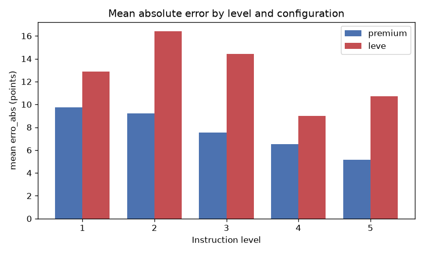
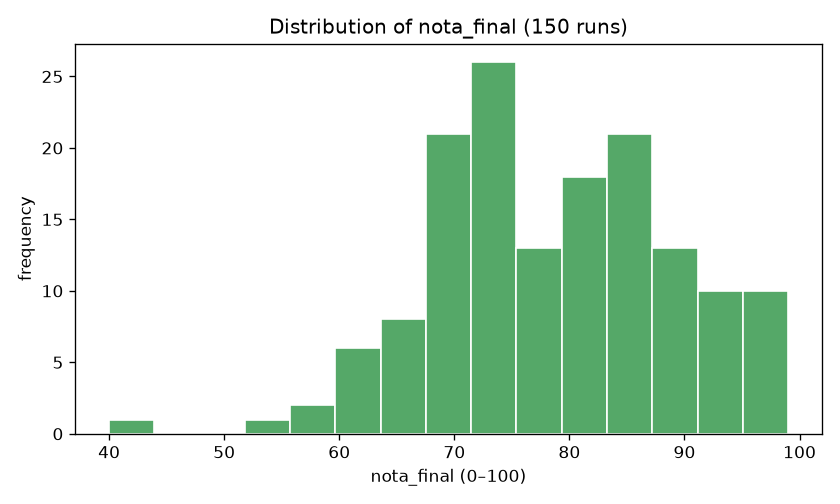
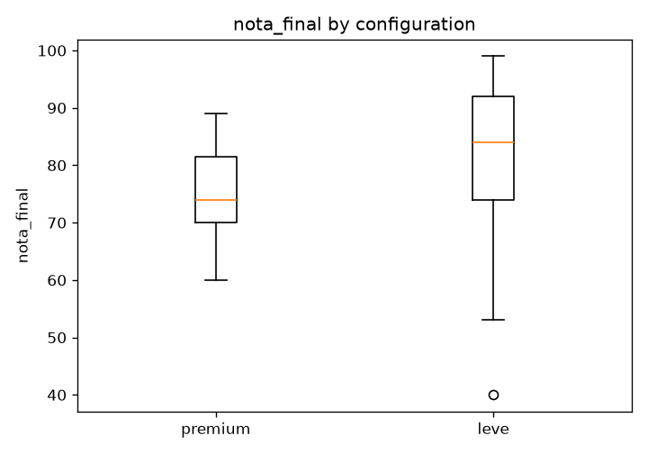
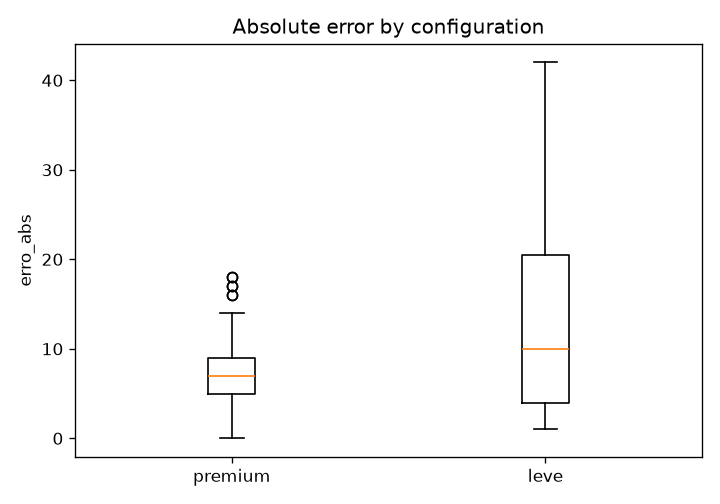
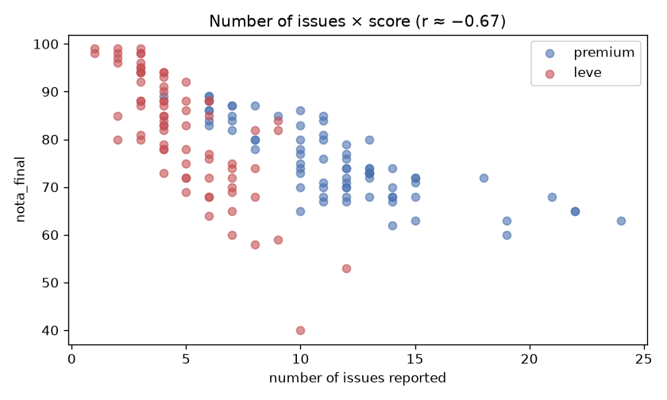
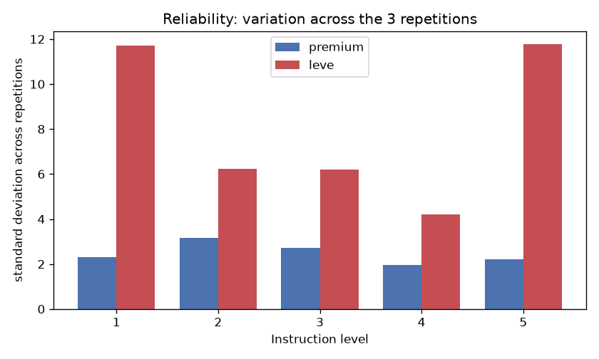
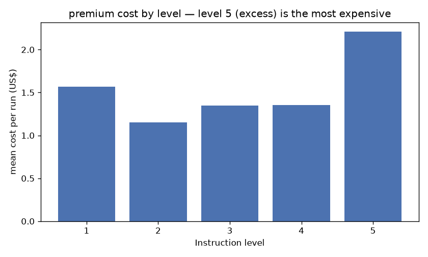
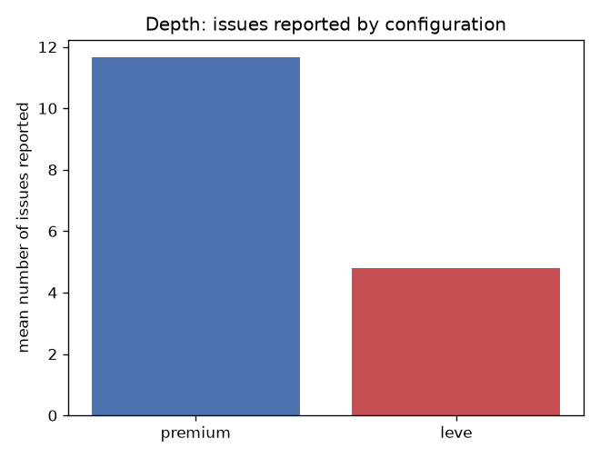

> 🇬🇧 English · 🇧🇷 [Português](relatorio-final.md)

# Final Report — Applied Statistics

**Topic:** Automated evaluation of source-code quality by AI models — the effect of the
instruction level and the model capacity on the accuracy, severity and cost of the evaluation.

**Author:** Augusto Henrique Buin — RA 1461392221018 — 4th DSM (individual project) · **Course:** Applied Statistics — DSM/FATEC

> Complete base: **150 runs** (premium = Claude Opus 4.8: 75 · leve = Gemini 3.5 Flash: 75).
> Exchange rate used in the conversions: **R$5.18 / US$**.

---

## Part 1 — Executive Summary

**Goal.** To investigate whether the level of detail of the instruction given to an AI model (scale 1–5) and the
capacity of the model (configuration *premium* vs. *leve*) affect how close the code-quality score
assigned by the AI gets to a human ground truth, in addition to the severity (number of problems) and the cost.

**Main results.** The absolute error relative to the ground truth **drops as the instruction increases**, but
in a way that **depends on the capacity of the model**: in premium the error drops monotonically (9.7 → 5.1
points from level 1 to 5; Spearman ρ = −0.36, p = 0.002); in leve the error improves up to level 4 but **gets
worse at level 5** (9.0 → 10.7) — the "excessive instruction confuses" effect appears **only in the leve model**. The
premium is significantly more accurate (median error 7 vs 10; p = 0.014), points out roughly **3× more
problems** (12 vs 4; p < 0.001) and is more consistent; leve is more lenient (score 84 vs 74; p < 0.001) and
**~3× less reliable** across repetitions. In cost, premium came out at **R$592.70** (US$114.42) and leve
at **R$209.95** — premium cost **~2.8× more**.

**Key findings.** (1) More instruction → less error. (2) The "excessive instruction" effect is
conditional: it confuses the weak model, not the strong one. (3) The depth (number of problems) separates the models
better than the score does. (4) Level 5 is the **most expensive** — and, in the leve model, also the one that goes back to erring.

**Recommendations.** Provide detailed rubrics to the AI; for depth analyses, prefer more
capable models; treat the AI score as an auxiliary estimate validated by a human; avoid excessive verbosity,
which increases cost without gain (and hurts lighter models).

---

## Part 2 — Introduction

**Topic.** Use of language models (AI) to automatically evaluate the quality of source code.

**Rationale.** Evaluating code quality is expensive and subjective, and AI tools promise to
automate it — but their reliability depends on little-studied factors, such as how much guidance is
given to the model and which model is used. For the developer, knowing when to trust these evaluations is a
practical and current skill.

**Research problem.** To what extent do the level of detail of the instruction (1–5) and the configuration of the
model (premium/leve) affect the accuracy (error vs. human ground truth), the severity (number of problems) and the
cost of automatic code-quality evaluation?

**Objectives.** General: to relate instruction level and model capacity to accuracy, severity and cost.
Specific: (i) to measure the error by level and configuration; (ii) to test whether the error drops from level 1 to 4 and whether it gets worse
at 5; (iii) to compare depth and cost across configurations; (iv) to evaluate the reliability across repetitions.

---

## Part 3 — Methodology

**Design.** Factorial experiment: **5 projects × 2 configurations × 5 levels × 3 repetitions = 150 runs**.
Each run is an independent evaluation of a project by an AI configuration under one instruction level.

**Collection instrument.** Instead of a questionnaire put to humans, the instrument is an **automated
experimental protocol** (the respondent is the AI model): (a) a **fixed rubric** of quality — 5 categories from 0
to 20 points summing to 100: c1 Functioning (ISO/IEC 25010, Functional Suitability), c2 Readability (Clean
Code), c3 Structure (DRY/SRP), c4 SOLID, c5 Non-functional (security/testing/performance), equal weights;
(b) **5 prompts** (levels 1–5) that **progressively reveal** the rubric, from the minimum of instruction to
excessive instruction — the manipulated factor; (c) **5 JSON schemas** that structure and validate the output;
(d) **2 configurations**; (e) **orchestration scripts** for the 150 runs. Each "question" of the instrument
is the application of a criterion; each "answer" is a recorded run with its metrics — satisfying
≥2 quantitative variables and ≥2 qualitative ones.

**Configurations.** *premium* = Claude Opus 4.8 (high reasoning effort); *leve* = Gemini 3.5 Flash. It is
a contrast of **capacity/tier**, not of brand (provider and capacity are confounded — see
Limitations). *Note:* leve was originally planned with Gemini 2.5 Flash, but the access route only served
the Flash of the current generation (3.5); 3.5 Flash was standardized on, the contemporary representative of the leve tier.

**Target audience.** Population: academic full-stack projects of DSM students. Sample: 5 team
projects from a 3rd-semester project-based learning (PBL) course (P1–P5), from the same domain (a *lead* management system; React + Node/Express
+ Prisma/PostgreSQL). Unit of observation: the evaluation run (n = 150).

**Collection method.** *Headless* execution of the models' CLIs over each repository, with the AI exploring
the files and returning structured JSON (score, sub-scores, problems, tokens, time, cost). AI instruction
files belonging to the projects themselves were **neutralized** during collection so as not to contaminate the evaluation.

**Ground truth.** The author scored the 5 projects by the complete rubric (5 sub-scores of 0–20 each),
**before** seeing the AI responses, in order to preserve independence. Reference scores G(projeto):
P1 = 78, P2 = 92, P3 = 62, P4 = 56, P5 = 71.

**Variables.** Qualitative: `projeto`, `configuracao`, `nivel_instrucao` (ordinal). Quantitative:
`nota_final` (0–100), sub-scores `c1`–`c5`, `n_problemas`, `tokens_total`, `cost_usd` (premium), `duration_ms`,
and the derived `erro_abs = |nota_final − G(projeto)|`.

---

## Part 4 — Data Treatment

- **Consolidation.** The raw JSONs were consolidated (`parse.js`) into `dados.csv` (1 row/run) and
  `problemas.csv` (1 row/problem). Total: 150 valid runs.
- **Missing values (structural).** The sub-scores `c1`–`c5` appear empty at the low levels **by
  design** (the rubric is revealed progressively: n1 with no categories; n2 c1–c2; n3 c1–c3; n4–n5 all) —
  *structural* absence, not a collection failure. That is why the central variable is `nota_final`, present at all
  levels. `cost_usd` is absent in leve (the CLI does not report cost).
- **Corrected inconsistency.** During validation it was detected that, at the partial-rubric levels (n2/n3), the
  leve model sometimes returned the `nota_final` on the wrong scale (the average of the sub-scores, e.g.: 9 instead of ~85).
  The instrument was corrected by anchoring the 0–100 scale in those prompts and the affected cells were regenerated.
- **Invalid runs.** Some failed due to provider quota limits (Claude session limit;
  Gemini credit exhaustion), were flagged and **redone** (resumable collection) — they do not enter the analyses.
- **Duplicates.** There are none: each run has a unique key (project, configuration, level, repetition).

---

## Part 5 — Data Quality Assessment

- **Representativeness.** Small and homogeneous sample (5 projects from the same domain/semester) — good for
  comparing the AI's behavior across levels/configurations, but it **limits generalization**.
- **Biases.** (i) **Single evaluator** in the ground truth (no inter-rater reliability). (ii)
  **Provider × capacity confounding** (premium=Anthropic, leve=Google) — to conclude in terms of
  "leve/premium configuration", never of brand. (iii) **Self-scoring**: the AI itself assigns the score.
- **Collection limitations.** Non-determinism of the models (hence the 3 repetitions); provider quotas/throttling;
  tokens not comparable across configurations (distinct tokenizers and caching).

---

## Part 6 — Descriptive Statistics

**Measures and formulas.** Let x₁,…,xₙ be the values of a variable:
- **Mean:** x̄ = (Σxᵢ)/n — the center of the data.
- **Median:** central value of the ordered list (average of the two central ones if n is even) — center robust to outliers.
- **Mode:** most frequent value.
- **Range:** A = xₘₐₓ − xₘᵢₙ — total span.
- **Sample variance:** s² = Σ(xᵢ − x̄)²/(n − 1) — average dispersion around the mean (units²).
- **Standard deviation:** s = √(s²) — dispersion in the original unit.
- **Coefficient of variation:** CV = (s/x̄)·100% — relative dispersion (compares different scales).

**Descriptive table (complete base, n = 150 → 75 per configuration):**

| Variable | Config | Mean | Median | Mode | Min | Max | Range | Variance | Std. dev. | CV |
|---|---|---|---|---|---|---|---|---|---|---|
| `nota_final` | premium | 75.21 | 74 | 68 | 60 | 89 | 29 | 59.17 | 7.69 | 10.2% |
| `nota_final` | leve | 82.03 | 84 | 88 | 40 | 99 | 59 | 150.11 | 12.25 | 14.9% |
| `n_problemas` | premium | 11.65 | 12 | 12 | 4 | 24 | 20 | 16.09 | 4.01 | 34.4% |
| `n_problemas` | leve | 4.80 | 4 | 4 | 1 | 12 | 11 | 4.81 | 2.19 | 45.7% |
| `erro_abs` | premium | 7.63 | 7 | 6 | 0 | 18 | 18 | 18.59 | 4.31 | 56.5% |
| `erro_abs` | leve | 12.68 | 10 | 2 | 1 | 42 | 41 | 99.65 | 9.98 | 78.7% |

*Interpretation:* premium is more **accurate** (mean error 7.6 vs 12.7) and more **consistent** (CV and
range of the error much smaller) than leve. leve gives higher scores (82 vs 75) and far more dispersed ones
(CV 14.9% vs 10.2%; range 59 vs 29) — reaching scores from 40 to 99. Premium points out ~2.4× more problems
(11.7 vs 4.8). In both, `erro_abs` is the most dispersed variable (high CV), since it depends strongly on the
condition (level/project) — exactly the object of the study.

**Cost (additional quantitative variable, premium configuration, US$):** mean $1.53/run, minimum $0.81,
maximum $3.22, sum **$114.42**. (leve does not report cost via the CLI; see Part 9.)

---

## Part 7 — Detailed Calculation (mean, variance and standard deviation)

The calculation is demonstrated step by step over a **sample of 20 observations** of the variable `nota_final` (the
first 20 premium runs, ordered by project, level and repetition). The same procedure holds for
any quantitative variable.

**Sample (n = 20):** 74, 65, 70, 80, 73, 80, 74, 72, 81, 73, 75, 71, 74, 74, 72, 86, 87, 88, 89, 89

**1) Mean** — sum of the values divided by the count:
```
x̄ = (Σ xᵢ) / n = 1547 / 20 = 77,35
```

**2) Sample variance** — mean of the squared deviations from the mean, with divisor (n − 1):
```
s² = Σ(xᵢ − x̄)² / (n − 1)
Σ(xᵢ − x̄)² = 972,55
s² = 972,55 / (20 − 1) = 972,55 / 19 = 51,19
```
> **Why (n − 1)?** The 150 runs are a **sample** of the AI's behavior, not the entire population;
> the divisor (n − 1) (Bessel's correction) corrects the underestimation. With divisor n it would give 972.55/20 = 48.63 —
> we report the **sample** variance, used consistently throughout the work.

**3) Standard deviation** — root of the variance, in the original unit (points):
```
s = √(s²) = √51,19 = 7,15
```

**Check in Python (same sample):** mean = 77.3500 · variance (n − 1) = 51.1868 · standard deviation =
7.1545 — **identical** to the calculations above (differences only from rounding). The work's conclusions use
the **complete base** (150), not just these 20 observations.

---

## Part 8 — Data Visualization

**1. Bar chart — error by level and configuration**



*Interpretation:* at all levels premium has lower error than leve. Premium always decreases; leve
does not — it rises from n1 to n2 and rises again at n5.

**2. Line chart — error trajectory (the central finding)**


*Interpretation:* premium (blue) drops **monotonically** (9.7 → 5.1). leve (red) improves up to
level 4 (9.0) but **gets worse again at 5** (10.7) — the "U-shaped rise" predicted for excessive instruction
**occurs only in the leve model**.

**3. Histogram — distribution of nota_final**



*Interpretation:* most scores cluster between ~70 and ~90; there is a left tail (low scores),
pulled mainly by leve, which has greater dispersion.

**4. Boxplot — nota_final by configuration**



*Interpretation:* leve has a higher median (more lenient) and a much larger box/whiskers (more variable,
with low outliers); premium is more concentrated.

**5. Boxplot — erro_abs by configuration**



*Interpretation:* leve's error is larger and far more spread out (reaching 42 points); premium's is smaller and
more contained.

**6. Scatter plot — number of problems × score**



*Interpretation:* **negative** relationship (r ≈ −0.67): the more problems the AI points out, the lower the score — internal
coherence. The premium points lie more to the right (more problems) and the leve points more to the left.

**7. Bars — reliability (variation across repetitions)**



*Interpretation:* premium is stable at all levels (~2–3). leve is much more unstable, especially at the
**extremes** (n1 = little instruction and n5 = excess), where the deviation across repetitions exceeds 11 points.

**8. Bars — premium cost by level**



*Interpretation:* level 5 (excessive instruction) is the **most expensive** ($2.21/run, +44% vs n2) — more
verbosity generates more tokens, more output and more time.

**9. Bars — depth (problems) by configuration**



*Interpretation:* premium points out on average ~2.4× more problems than leve — the depth of the analysis is what
most separates the two capacities.

---

## Part 9 — Statistical Comparisons

**Premium × leve (Mann-Whitney U test, non-parametric):**

| Variable | Median premium | Median leve | U | p-value | Result |
|---|---|---|---|---|---|
| `erro_abs` | 7.0 | 10.0 | 2158 | 0.0138 | **premium more accurate** (sig.) |
| `n_problemas` | 12.0 | 4.0 | 5315 | < 0.001 | **premium points out more** (sig.) |
| `nota_final` | 74.0 | 84.0 | 1684 | < 0.001 | **leve more lenient** (sig.) |

All three differences are statistically significant (α = 0.05).

**Cost comparison (premium × leve):**

| | Claude (premium) | Gemini (leve) |
|---|---|---|
| Total cost | US$114.42 ≈ **R$592.70** | **R$209.95** ≈ US$40.53 |
| Cost per run | US$1.53 ≈ **R$7.90** | **R$2.80** ≈ US$0.54 |
| Mean time/run | 226 s | 124 s |

→ premium cost **~2.8× more** (per run and in total). *Caveat:* the Gemini figure is the gross spend
(it includes attempts that failed due to quota and the model re-collection), whereas the Claude one is practically only
valid runs (its failures were instantaneous, cost ≈ 0). Tokens are **not** compared ($ and time are). 

**Comparison across levels (the "U" test).** Difference in error from level 4 to 5: premium **−1.40** (improves);
leve **+1.73** (gets worse). It confirms that excessive instruction only harms the leve model.

---

## Part 10 — Implementation in Python

Notebook on Google Colab (`notebook_colab.ipynb`): data import, cleaning, calculation of `erro_abs` by
crossing with the ground truth, descriptive statistics, the charts, comparisons (Mann-Whitney), correlations,
reliability and cost, with explanatory comments. It uses the entire base (150).

**Google Colab link:** https://colab.research.google.com/drive/1d2QHmFEUB4UFTtklEqs6vscVBlovVApI?usp=sharing

---

## Part 11 — Discussion of the Results

The central result has two layers. First, **accuracy improves with instruction**: revealing the rubric
brings the AI's score closer to the human score (premium: ρ = −0.36, p = 0.002). Second — and more
interesting — this effect **depends on the capacity of the model**: premium keeps improving up to level 5, whereas leve
**gets worse at 5**. That is, the hypothesis that "excessive instruction confuses" is true, but only for the
lower-capacity model; the strong model filters out the verbosity and takes advantage of the additional information.

This "U" pattern of leve also explains why the Spearman correlation level×error is **significant in
premium but not in leve**: leve's relationship is not monotonic, so the linear coefficient approaches
zero even though there is a clear pattern — hence the importance of looking at the chart and comparing n4 vs n5, not just the number.

leve is also **far less reliable** (deviation across repetitions ~3× that of premium), with worse stability
precisely at the extremes (little instruction and excess). And there is a **cost×quality trade-off**: premium costs
~2.8× more, but is more accurate and points out ~3× more problems — depth comes at a price. Level 5 illustrates the
"worst of both worlds" for leve: it is the **most expensive** (more tokens) and still **goes back to erring**.

Finally, the strong negative relationship between number of problems and score (r ≈ −0.67 to −0.78) shows internal coherence:
the AI effectively penalizes what it finds; the difference in capacity lies more in **how much** it finds.

**Content reliability (hallucination analysis).** A sample of 30 reported problems (15 per configuration) was
manually verified against the actual code. The **hallucination** rate (factually false claims)
was low: **0% in premium and 6.7% in leve** (~3.3% overall); the vast majority of the claims are
correct. leve's failures are concentrated in **partial inaccuracies** (the fact exists, but the described mechanism
is imprecise) and in the single observed hallucination — a compiler warning that is not even enabled in the
project. That is, besides pointing out **fewer** problems, leve is slightly less precise **in what** it points out,
reinforcing the capacity contrast. (Details in `analise-alucinacao/alucinacao_resultados.en.md`.)

---

## Part 12 — Study Limitations

- Small sample and of a **single domain** (5 projects of the same type) → limited generalization.
- **Single-evaluator ground truth** → no inter-rater reliability; evaluator bias.
- **Provider × capacity confounding** → conclusions about "tier", not about brands.
- AI **self-scoring** and **non-determinism** (mitigated by repetitions).
- Observations **not fully independent** (3 repetitions per condition; the same 5 projects).
- **Model switch in leve** (2.5 → 3.5 Flash) due to access restriction — disclosed.
- **Tokens not comparable** across configurations; the Gemini cost is gross spend (includes quota overhead).

---

## Part 13 — Key Findings

1. **More instruction, less error.** The error drops with the instruction level (premium: 9.7 → 5.1; ρ = −0.36, p = 0.002).
2. **The "U-shaped effect" is conditional on capacity.** Excessive instruction (level 5) worsens the **leve**
   model (9.0 → 10.7) but **not** premium (6.5 → 5.1) — the headline finding of the work.
3. **Depth reveals the tier.** Premium points out ~3× more problems than leve (12 vs 4; p < 0.001), even
   when the scores do not differ so much — the problem count separates the models better than the score does.
4. **leve is more lenient and far less reliable** (score 84 vs 74, p < 0.001; deviation across repetitions ~3×
   larger), with worse stability at the instruction extremes.
5. **Cost grows with verbosity.** Level 5 is the most expensive (premium $2.21/run, +44% vs n2); and premium
   costs ~2.8× leve (R$592.70 vs R$209.95) — accuracy/depth come at a price.
6. **Internal coherence.** Strong negative relationship between number of problems and score (r ≈ −0.67 to −0.78).
7. **Little hallucination.** In a sample of 30 problems verified against the actual code, the rate of false
   claims was ~3.3% (**0% in premium, 6.7% in leve**) — the models rarely make things up; the inaccuracies,
   when they occur, are of detail/framing and more common in leve.

---

## Part 14 — Conclusion

The quality of the instruction given to a code-evaluating AI matters: revealing the rubric brings the evaluation
closer to human judgment and makes it more consistent. But the effect of **excessive** instruction depends on the
capacity of the model — it confuses leve, not the strong one. Capacity weighs above all on the **depth** of the
analysis (number of problems) and on the **reliability**. There is a clear **cost×quality** trade-off: the
more capable configuration costs ~2.8× more, delivering greater accuracy and depth. To use AI in the evaluation
of code, the practical recommendation is: a detailed rubric (but not excessively verbose), a capable model for
depth, and human validation — treating the AI score as an estimate, not a verdict.

---

## Part 15 — Recommendations

1. **Provide the detailed rubric/criteria** to the AI — clear instruction reduces error and bias.
2. **Avoid excessive verbosity:** it increases cost (level 5 is the most expensive) and, in lighter models, worsens the
   result. There is an optimal point of instruction (around level 4).
3. **Prefer more capable models for depth analyses** (problem detection); for fast and cheap
   triage, leve will do, mindful of its lower accuracy and reliability.
4. **Treat the AI score as an auxiliary estimate**, validated by a human in important decisions — there is a leniency
   bias, especially without explicit criteria.

---

## Part 16 — References

**Statistics**
- BUSSAB, W. O.; MORETTIN, P. A. *Estatística Básica*. 9. ed. São Paulo: Saraiva, 2017.
- MANN, H. B.; WHITNEY, D. R. On a test of whether one of two random variables is stochastically larger than
  the other. *Annals of Mathematical Statistics*, v. 18, n. 1, p. 50–60, 1947. (Mann-Whitney test)
- SPEARMAN, C. The proof and measurement of association between two things. *American Journal of Psychology*,
  v. 15, p. 72–101, 1904. (rank correlation)

**Software quality**
- ISO/IEC 25010:2011. *Systems and software engineering — SQuaRE — System and software quality models*. Geneva: ISO, 2011.
- MARTIN, R. C. *Clean Code: A Handbook of Agile Software Craftsmanship*. Upper Saddle River: Prentice Hall, 2008.
- MARTIN, R. C. *Agile Software Development: Principles, Patterns, and Practices*. Prentice Hall, 2003. (SOLID, DRY, SRP)

**Tools and libraries**
- ANTHROPIC. *Claude (Opus model) — documentation*. https://docs.anthropic.com. Accessed: Jun. 2026.
- GOOGLE. *Gemini API — documentation*. https://ai.google.dev. Accessed: Jun. 2026.
- McKINNEY, W. Data structures for statistical computing in Python. In: *Proc. 9th Python in Science Conf.*, 2010. (pandas)
- HARRIS, C. R. et al. Array programming with NumPy. *Nature*, v. 585, p. 357–362, 2020.
- VIRTANEN, P. et al. SciPy 1.0. *Nature Methods*, v. 17, p. 261–272, 2020.
- HUNTER, J. D. Matplotlib: a 2D graphics environment. *Computing in Science & Engineering*, v. 9, n. 3, p. 90–95, 2007.

---

## Part 17 — Appendices

- **Collection instrument:** rubric (`rubrica-qualidade-codigo.md`), prompts (`prompt_n1..n5.txt`),
  schemas (`schema_n1..n5.json`) and collection scripts (`run_all.sh`, `run_worker.sh`, `parse.js`).
- **Database:** `dados.csv`, `problemas.csv`, `gabarito_computed.csv`.
- **Charts:** the `graficos/` folder.
- **Google Colab link:** https://colab.research.google.com/drive/1d2QHmFEUB4UFTtklEqs6vscVBlovVApI?usp=sharing
- **Collection evidence:** execution logs and raw JSONs (`resultados/`).
