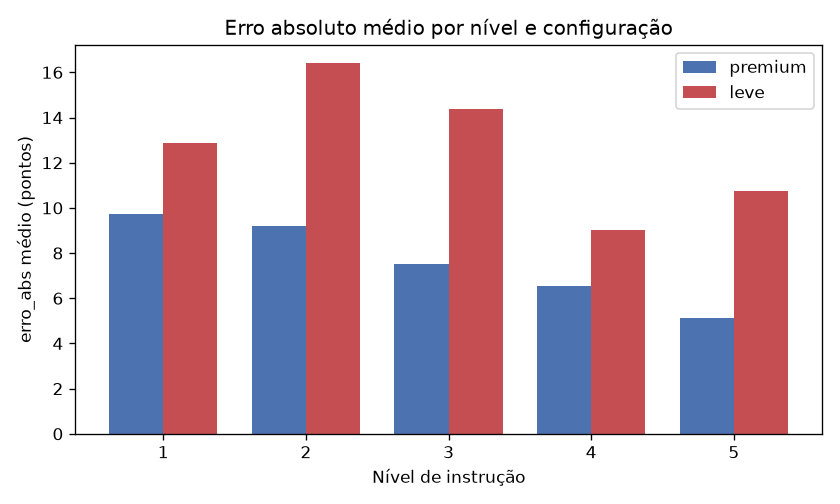
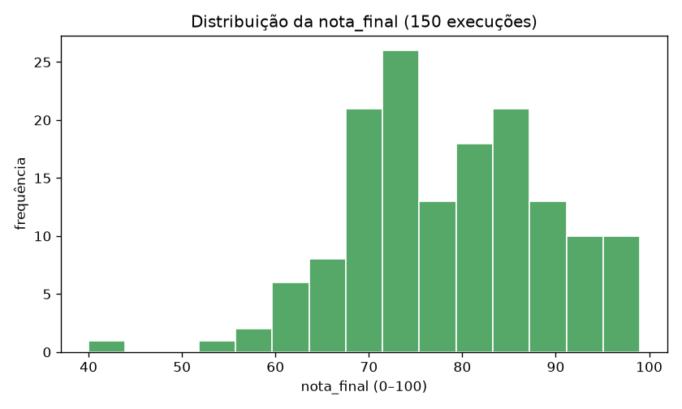
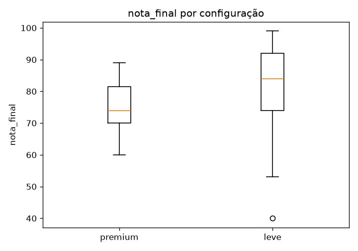
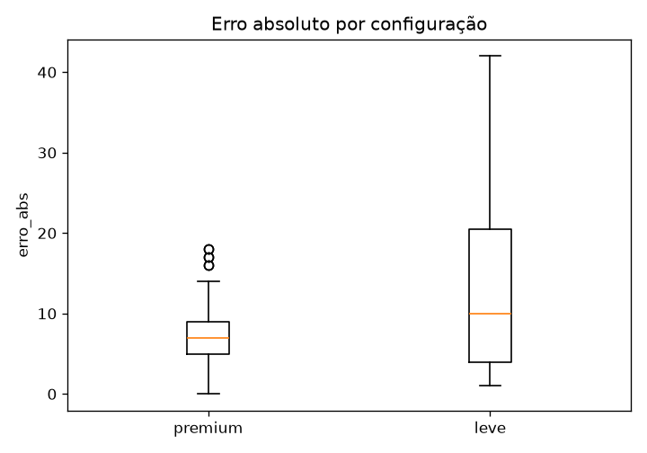
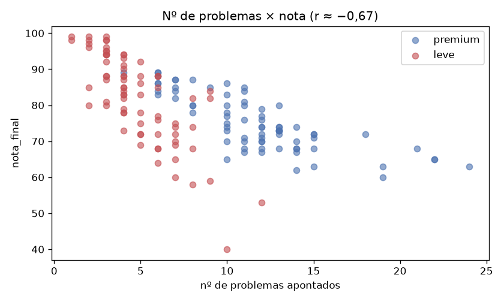
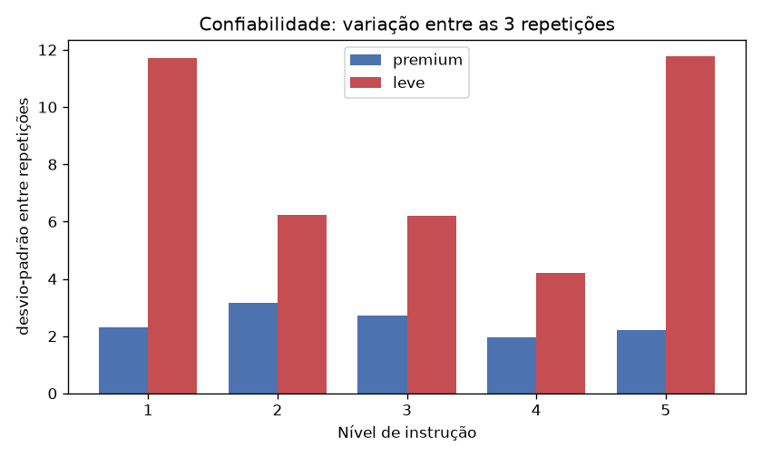
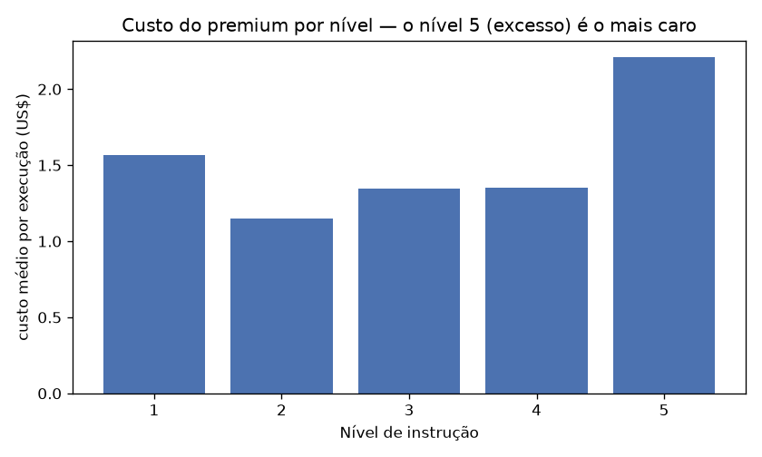
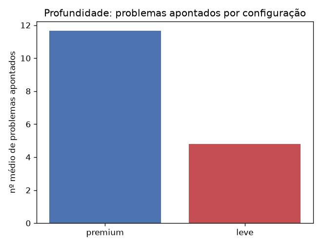

> 🇧🇷 Português · 🇬🇧 [English](relatorio-final.en.md)

# Relatório Final — Estatística Aplicada

**Tema:** Avaliação automatizada da qualidade de código-fonte por modelos de IA — efeito do nível de
instrução e da capacidade do modelo sobre a precisão, a severidade e o custo da avaliação.

**Autor:** Augusto Henrique Buin — RA 1461392221018 — 4º DSM (trabalho individual) · **Disciplina:** Estatística Aplicada — DSM/FATEC

> Base completa: **150 execuções** (premium = Claude Opus 4.8: 75 · leve = Gemini 3.5 Flash: 75).
> Câmbio usado nas conversões: **R$ 5,18 / US$**.

---

## Parte 1 — Resumo Executivo

**Objetivo.** Investigar se o nível de detalhamento da instrução dada a um modelo de IA (escala 1–5) e a
capacidade do modelo (configuração *premium* vs. *leve*) afetam o quanto a nota de qualidade de código
atribuída pela IA se aproxima de um gabarito humano, além da severidade (nº de problemas) e do custo.

**Principais resultados.** O erro absoluto em relação ao gabarito **cai quando a instrução aumenta**, mas
de forma **dependente da capacidade do modelo**: no premium o erro cai de forma monotônica (9,7 → 5,1
pontos do nível 1 ao 5; Spearman ρ = −0,36, p = 0,002); no leve o erro melhora até o nível 4 mas **piora
no nível 5** (9,0 → 10,7) — o efeito "instrução excessiva confunde" aparece **apenas no modelo leve**. O
premium é significativamente mais preciso (erro mediano 7 vs 10; p = 0,014), aponta cerca de **3× mais
problemas** (12 vs 4; p < 0,001) e é mais consistente; o leve é mais generoso (nota 84 vs 74; p < 0,001) e
**~3× menos confiável** entre repetições. Em custo, o premium saiu por **R$ 592,70** (US$ 114,42) e o leve
por **R$ 209,95** — o premium custou **~2,8× mais**.

**Principais descobertas.** (1) Mais instrução → menos erro. (2) O efeito de "excesso de instrução" é
condicional: confunde o modelo fraco, não o forte. (3) A profundidade (nº de problemas) separa os modelos
melhor que a nota. (4) O nível 5 é o **mais caro** — e, no modelo leve, também o que volta a errar.

**Recomendações.** Fornecer rubricas detalhadas à IA; para análises de profundidade, preferir modelos mais
capazes; tratar a nota da IA como estimativa auxiliar validada por humano; evitar verbosidade excessiva,
que aumenta custo sem ganho (e prejudica modelos leves).

---

## Parte 2 — Introdução

**Tema.** Uso de modelos de linguagem (IA) para avaliar automaticamente a qualidade de código-fonte.

**Justificativa.** Avaliar qualidade de código é caro e subjetivo, e ferramentas de IA prometem
automatizá-lo — mas sua confiabilidade depende de fatores pouco estudados, como o quanto de orientação se
dá ao modelo e qual modelo se usa. Para o desenvolvedor, saber quando confiar nessas avaliações é uma
competência prática e atual.

**Problema de investigação.** Em que medida o nível de detalhamento da instrução (1–5) e a configuração do
modelo (premium/leve) afetam a precisão (erro vs. gabarito humano), a severidade (nº de problemas) e o
custo da avaliação automática de qualidade de código?

**Objetivos.** Geral: relacionar nível de instrução e capacidade do modelo à precisão, severidade e custo.
Específicos: (i) medir o erro por nível e configuração; (ii) testar se o erro cai do nível 1 ao 4 e se piora
no 5; (iii) comparar profundidade e custo entre configurações; (iv) avaliar a confiabilidade entre repetições.

---

## Parte 3 — Metodologia

**Desenho.** Experimento fatorial: **5 projetos × 2 configurações × 5 níveis × 3 repetições = 150 execuções**.
Cada execução é uma avaliação independente de um projeto por uma configuração de IA sob um nível de instrução.

**Instrumento de coleta.** Em vez de questionário a humanos, o instrumento é um **protocolo experimental
automatizado** (o respondente é o modelo de IA): (a) uma **rubrica fixa** de qualidade — 5 categorias de 0
a 20 pontos somando 100: c1 Funcionamento (ISO/IEC 25010, Adequação Funcional), c2 Legibilidade (Clean
Code), c3 Estrutura (DRY/SRP), c4 SOLID, c5 Não-funcionais (segurança/testes/performance), pesos iguais;
(b) **5 prompts** (níveis 1–5) que **revelam progressivamente** a rubrica, do mínimo de instrução à
instrução excessiva — o fator manipulado; (c) **5 esquemas JSON** que estruturam e validam a saída;
(d) **2 configurações**; (e) **scripts de orquestração** das 150 execuções. Cada "pergunta" do instrumento
é a aplicação de um critério; cada "resposta" é uma execução registrada com suas métricas — atendendo a
≥2 variáveis quantitativas e ≥2 qualitativas.

**Configurações.** *premium* = Claude Opus 4.8 (esforço de raciocínio alto); *leve* = Gemini 3.5 Flash. É
um contraste de **capacidade/tier**, não de marca (fornecedor e capacidade estão confundidos — ver
Limitações). *Nota:* o leve foi originalmente planejado com Gemini 2.5 Flash, mas a via de acesso só servia
o Flash de geração atual (3.5); padronizou-se em 3.5 Flash, representante contemporâneo do tier leve.

**Público-alvo.** População: projetos acadêmicos full-stack de estudantes de DSM. Amostra: 5 projetos de
equipe da ABP do 3º semestre (P1–P5), do mesmo domínio (sistema de gestão de *leads*; React + Node/Express
+ Prisma/PostgreSQL). Unidade de observação: a execução de avaliação (n = 150).

**Forma de coleta.** Execução *headless* das CLIs dos modelos sobre cada repositório, com a IA explorando
os arquivos e devolvendo JSON estruturado (nota, sub-notas, problemas, tokens, tempo, custo). Arquivos de
instrução de IA dos próprios projetos foram **neutralizados** durante a coleta para não contaminar a avaliação.

**Gabarito (ground truth).** O autor pontuou os 5 projetos pela rubrica completa (5 sub-notas de 0–20 cada),
**antes** de ver as respostas da IA, para preservar a independência. Notas de referência G(projeto):
P1 = 78, P2 = 92, P3 = 62, P4 = 56, P5 = 71.

**Variáveis.** Qualitativas: `projeto`, `configuracao`, `nivel_instrucao` (ordinal). Quantitativas:
`nota_final` (0–100), sub-notas `c1`–`c5`, `n_problemas`, `tokens_total`, `cost_usd` (premium), `duration_ms`,
e a derivada `erro_abs = |nota_final − G(projeto)|`.

---

## Parte 4 — Tratamento dos Dados

- **Consolidação.** Os JSONs brutos foram consolidados (`parse.js`) em `dados.csv` (1 linha/execução) e
  `problemas.csv` (1 linha/problema). Total: 150 execuções válidas.
- **Valores ausentes (estruturais).** As sub-notas `c1`–`c5` aparecem vazias nos níveis baixos **por
  desenho** (a rubrica é revelada progressivamente: n1 sem categorias; n2 c1–c2; n3 c1–c3; n4–n5 todas) —
  ausência *estrutural*, não falha de coleta. Por isso a variável central é `nota_final`, presente em todos
  os níveis. `cost_usd` é ausente no leve (a CLI não reporta custo).
- **Inconsistência corrigida.** Na validação detectou-se que, nos níveis de rubrica parcial (n2/n3), o
  modelo leve às vezes devolvia a `nota_final` na escala errada (média das sub-notas, ex.: 9 em vez de ~85).
  Corrigiu-se o instrumento ancorando a escala 0–100 nesses prompts e regeneraram-se as células afetadas.
- **Execuções inválidas.** Algumas falharam por limites de cota dos provedores (limite de sessão do Claude;
  esgotamento de créditos do Gemini), foram marcadas e **refeitas** (coleta resumível) — não entram nas análises.
- **Duplicatas.** Não há: cada execução tem chave única (projeto, configuração, nível, repetição).

---

## Parte 5 — Avaliação da Qualidade dos Dados

- **Representatividade.** Amostra pequena e homogênea (5 projetos do mesmo domínio/semestre) — boa para
  comparar o comportamento da IA entre níveis/configurações, mas **limita a generalização**.
- **Vieses.** (i) **Avaliador único** no gabarito (sem confiabilidade entre avaliadores). (ii)
  **Confundimento fornecedor × capacidade** (premium=Anthropic, leve=Google) — concluir em termos de
  "configuração leve/premium", nunca de marca. (iii) **Auto-pontuação**: a própria IA atribui a nota.
- **Limitações da coleta.** Não-determinismo dos modelos (daí as 3 repetições); cotas/throttling dos
  provedores; tokens não comparáveis entre configurações (tokenizadores e cache distintos).

---

## Parte 6 — Estatística Descritiva

**Medidas e fórmulas.** Sendo x₁,…,xₙ os valores de uma variável:
- **Média:** x̄ = (Σxᵢ)/n — o centro dos dados.
- **Mediana:** valor central da lista ordenada (média dos dois centrais se n par) — centro robusto a outliers.
- **Moda:** valor mais frequente.
- **Amplitude:** A = xₘₐₓ − xₘᵢₙ — alcance total.
- **Variância amostral:** s² = Σ(xᵢ − x̄)²/(n − 1) — dispersão média em torno da média (unidades²).
- **Desvio-padrão:** s = √(s²) — dispersão na unidade original.
- **Coeficiente de variação:** CV = (s/x̄)·100% — dispersão relativa (compara escalas diferentes).

**Tabela descritiva (base completa, n = 150 → 75 por configuração):**

| Variável | Config | Média | Mediana | Moda | Mín | Máx | Ampl. | Variância | Desvio | CV |
|---|---|---|---|---|---|---|---|---|---|---|
| `nota_final` | premium | 75,21 | 74 | 68 | 60 | 89 | 29 | 59,17 | 7,69 | 10,2% |
| `nota_final` | leve | 82,03 | 84 | 88 | 40 | 99 | 59 | 150,11 | 12,25 | 14,9% |
| `n_problemas` | premium | 11,65 | 12 | 12 | 4 | 24 | 20 | 16,09 | 4,01 | 34,4% |
| `n_problemas` | leve | 4,80 | 4 | 4 | 1 | 12 | 11 | 4,81 | 2,19 | 45,7% |
| `erro_abs` | premium | 7,63 | 7 | 6 | 0 | 18 | 18 | 18,59 | 4,31 | 56,5% |
| `erro_abs` | leve | 12,68 | 10 | 2 | 1 | 42 | 41 | 99,65 | 9,98 | 78,7% |

*Interpretação:* o premium é mais **acurado** (erro médio 7,6 vs 12,7) e mais **consistente** (CV e
amplitude do erro bem menores) que o leve. O leve dá notas mais altas (82 vs 75) e muito mais dispersas
(CV 14,9% vs 10,2%; amplitude 59 vs 29) — chega a notas de 40 a 99. O premium aponta ~2,4× mais problemas
(11,7 vs 4,8). Em ambos, o `erro_abs` é a variável mais dispersa (CV alto), pois depende fortemente da
condição (nível/projeto) — exatamente o objeto do estudo.

**Custo (variável quantitativa adicional, configuração premium, US$):** média $1,53/exec, mínimo $0,81,
máximo $3,22, soma **$114,42**. (O leve não reporta custo pela CLI; ver Parte 9.)

---

## Parte 7 — Cálculo Detalhado (média, variância e desvio-padrão)

O cálculo é demonstrado passo a passo sobre uma **amostra de 20 observações** da variável `nota_final` (as
20 primeiras execuções premium, ordenadas por projeto, nível e repetição). O mesmo procedimento vale para
qualquer variável quantitativa.

**Amostra (n = 20):** 74, 65, 70, 80, 73, 80, 74, 72, 81, 73, 75, 71, 74, 74, 72, 86, 87, 88, 89, 89

**1) Média** — soma dos valores dividida pela quantidade:
```
x̄ = (Σ xᵢ) / n = 1547 / 20 = 77,35
```

**2) Variância amostral** — média dos quadrados dos desvios em relação à média, com divisor (n − 1):
```
s² = Σ(xᵢ − x̄)² / (n − 1)
Σ(xᵢ − x̄)² = 972,55
s² = 972,55 / (20 − 1) = 972,55 / 19 = 51,19
```
> **Por que (n − 1)?** As 150 execuções são uma **amostra** do comportamento da IA, não a população inteira;
> o divisor (n − 1) (correção de Bessel) corrige a subestimação. Com divisor n daria 972,55/20 = 48,63 —
> reportamos a variância **amostral**, usada de forma consistente em todo o trabalho.

**3) Desvio-padrão** — raiz da variância, na unidade original (pontos):
```
s = √(s²) = √51,19 = 7,15
```

**Conferência em Python (mesma amostra):** média = 77,3500 · variância (n − 1) = 51,1868 · desvio-padrão =
7,1545 — **idênticos** aos cálculos acima (diferenças só de arredondamento). As conclusões do trabalho usam
a **base completa** (150), não apenas estas 20 observações.

---

## Parte 8 — Visualização dos Dados

**1. Gráfico de barras — erro por nível e configuração**



*Interpretação:* em todos os níveis o premium tem erro menor que o leve. O premium decresce sempre; o leve
não — sobe do n1 ao n2 e volta a subir no n5.

**2. Gráfico de linhas — trajetória do erro (o achado central)**


*Interpretação:* o premium (azul) cai de forma **monotônica** (9,7 → 5,1). O leve (vermelho) melhora até o
nível 4 (9,0) mas **volta a piorar no 5** (10,7) — a "subida em U" prevista para instrução excessiva
**ocorre só no modelo leve**.

**3. Histograma — distribuição da nota_final**



*Interpretação:* a maioria das notas concentra-se entre ~70 e ~90; há uma cauda à esquerda (notas baixas),
puxada sobretudo pelo leve, que tem maior dispersão.

**4. Boxplot — nota_final por configuração**



*Interpretação:* o leve tem mediana mais alta (mais generoso) e caixa/bigodes bem maiores (mais variável,
com outliers baixos); o premium é mais concentrado.

**5. Boxplot — erro_abs por configuração**



*Interpretação:* o erro do leve é maior e muito mais espalhado (chega a 42 pontos); o do premium é menor e
mais contido.

**6. Gráfico de dispersão — nº de problemas × nota**



*Interpretação:* relação **negativa** (r ≈ −0,67): quanto mais problemas a IA aponta, menor a nota — coerência
interna. Os pontos do premium ficam mais à direita (mais problemas) e os do leve mais à esquerda.

**7. Barras — confiabilidade (variação entre repetições)**



*Interpretação:* o premium é estável em todos os níveis (~2–3). O leve é muito mais instável, sobretudo nos
**extremos** (n1 = pouca instrução e n5 = excesso), onde o desvio entre repetições passa de 11 pontos.

**8. Barras — custo do premium por nível**



*Interpretação:* o nível 5 (instrução excessiva) é o **mais caro** ($2,21/exec, +44% vs o n2) — mais
verbosidade gera mais tokens, mais saída e mais tempo.

**9. Barras — profundidade (problemas) por configuração**



*Interpretação:* o premium aponta em média ~2,4× mais problemas que o leve — a profundidade da análise é o
que mais separa as duas capacidades.

---

## Parte 9 — Comparações Estatísticas

**Premium × leve (teste de Mann-Whitney U, não-paramétrico):**

| Variável | Mediana premium | Mediana leve | U | p-valor | Resultado |
|---|---|---|---|---|---|
| `erro_abs` | 7,0 | 10,0 | 2158 | 0,0138 | **premium mais preciso** (sig.) |
| `n_problemas` | 12,0 | 4,0 | 5315 | < 0,001 | **premium aponta mais** (sig.) |
| `nota_final` | 74,0 | 84,0 | 1684 | < 0,001 | **leve mais generoso** (sig.) |

As três diferenças são estatisticamente significativas (α = 0,05).

**Comparação de custo (premium × leve):**

| | Claude (premium) | Gemini (leve) |
|---|---|---|
| Custo total | US$ 114,42 ≈ **R$ 592,70** | **R$ 209,95** ≈ US$ 40,53 |
| Custo por execução | US$ 1,53 ≈ **R$ 7,90** | **R$ 2,80** ≈ US$ 0,54 |
| Tempo médio/exec | 226 s | 124 s |

→ O premium custou **~2,8× mais** (por execução e no total). *Ressalva:* o valor do Gemini é o gasto bruto
(inclui tentativas que falharam por cota e a re-coleta de modelo), enquanto o do Claude é praticamente só
execuções válidas (suas falhas foram instantâneas, custo ≈ 0). Tokens **não** são comparados ($ e tempo sim).

**Comparação entre níveis (teste do "U").** Diferença de erro do nível 4 para o 5: premium **−1,40** (melhora);
leve **+1,73** (piora). Confirma que o excesso de instrução só prejudica o modelo leve.

---

## Parte 10 — Implementação em Python

Notebook no Google Colab (`notebook_colab.ipynb`): importação dos dados, limpeza, cálculo do `erro_abs` por
cruzamento com o gabarito, estatística descritiva, os gráficos, comparações (Mann-Whitney), correlações,
confiabilidade e custo, com comentários explicativos. Usa toda a base (150).

**Link do Google Colab:** https://colab.research.google.com/drive/1d2QHmFEUB4UFTtklEqs6vscVBlovVApI?usp=sharing

---

## Parte 11 — Discussão dos Resultados

O resultado central tem duas camadas. Primeiro, **a precisão melhora com a instrução**: revelar a rubrica
aproxima a nota da IA da nota humana (premium: ρ = −0,36, p = 0,002). Segundo — e mais interessante — esse
efeito **depende da capacidade do modelo**: o premium continua melhorando até o nível 5, enquanto o leve
**piora no 5**. Ou seja, a hipótese de que "instrução excessiva confunde" é verdadeira, mas apenas para o
modelo de menor capacidade; o modelo forte filtra a verbosidade e aproveita a informação adicional.

Esse padrão em "U" do leve explica também por que a correlação de Spearman nível×erro é **significativa no
premium mas não no leve**: a relação do leve não é monotônica, então o coeficiente linear se aproxima de
zero mesmo havendo um padrão claro — daí a importância de olhar o gráfico e comparar n4 vs n5, não só o número.

O leve é ainda **muito menos confiável** (desvio entre repetições ~3× o do premium), com pior estabilidade
justamente nos extremos (pouca instrução e excesso). E há um **trade-off custo×qualidade**: o premium custa
~2,8× mais, mas é mais preciso e aponta ~3× mais problemas — a profundidade tem preço. O nível 5 ilustra o
"pior dos dois mundos" para o leve: é o **mais caro** (mais tokens) e ainda **volta a errar**.

Por fim, a forte relação negativa entre nº de problemas e nota (r ≈ −0,67 a −0,78) mostra coerência interna:
a IA efetivamente penaliza o que encontra; a diferença de capacidade está mais em **quanto** ela encontra.

**Confiabilidade do conteúdo (análise de alucinação).** Verificou-se manualmente, contra o código real, uma
amostra de 30 problemas apontados (15 por configuração). A taxa de **alucinação** (alegações factualmente
falsas) foi baixa: **0% no premium e 6,7% no leve** (~3,3% no geral); a grande maioria das alegações é
correta. As falhas do leve concentram-se em **imprecisões parciais** (o fato existe, mas o mecanismo descrito
está impreciso) e na única alucinação observada — um aviso de compilador que sequer está habilitado no
projeto. Ou seja, além de apontar **menos** problemas, o leve é um pouco menos preciso **naquilo que** aponta,
reforçando o contraste de capacidade. (Detalhe em `analise-alucinacao/alucinacao_resultados.md`.)

---

## Parte 12 — Limitações do Estudo

- Amostra pequena e de **domínio único** (5 projetos do mesmo tipo) → generalização limitada.
- **Gabarito de avaliador único** → sem confiabilidade entre avaliadores; viés do avaliador.
- **Confundimento fornecedor × capacidade** → conclusões sobre "tier", não sobre marcas.
- **Auto-pontuação** da IA e **não-determinismo** (mitigado por repetições).
- Observações **não totalmente independentes** (3 repetições por condição; mesmos 5 projetos).
- **Troca de modelo no leve** (2.5 → 3.5 Flash) por restrição de acesso — declarada.
- **Tokens não comparáveis** entre configurações; custo do Gemini é gasto bruto (inclui overhead de cota).

---

## Parte 13 — Principais Descobertas

1. **Mais instrução, menos erro.** O erro cai com o nível de instrução (premium: 9,7 → 5,1; ρ = −0,36, p = 0,002).
2. **O "efeito-U" é condicional à capacidade.** O excesso de instrução (nível 5) piora o modelo **leve**
   (9,0 → 10,7) mas **não** o premium (6,5 → 5,1) — descoberta-título do trabalho.
3. **Profundidade revela o tier.** O premium aponta ~3× mais problemas que o leve (12 vs 4; p < 0,001), mesmo
   quando as notas não diferem tanto — a contagem de problemas separa os modelos melhor que a nota.
4. **O leve é mais generoso e muito menos confiável** (nota 84 vs 74, p < 0,001; desvio entre repetições ~3×
   maior), com pior estabilidade nos extremos de instrução.
5. **Custo cresce com a verbosidade.** O nível 5 é o mais caro (premium $2,21/exec, +44% vs n2); e o premium
   custa ~2,8× o leve (R$ 592,70 vs R$ 209,95) — a precisão/profundidade têm preço.
6. **Coerência interna.** Forte relação negativa entre nº de problemas e nota (r ≈ −0,67 a −0,78).
7. **Pouca alucinação.** Numa amostra de 30 problemas verificados contra o código real, a taxa de alegações
   falsas foi ~3,3% (**0% no premium, 6,7% no leve**) — os modelos raramente inventam; as imprecisões,
   quando ocorrem, são de detalhe/enquadramento e mais comuns no leve.

---

## Parte 14 — Conclusão

A qualidade da instrução dada a uma IA avaliadora de código importa: revelar a rubrica aproxima a avaliação
do julgamento humano e a torna mais consistente. Mas o efeito do **excesso** de instrução depende da
capacidade do modelo — confunde o leve, não o forte. A capacidade pesa sobretudo na **profundidade** da
análise (quantidade de problemas) e na **confiabilidade**. Há um trade-off claro de **custo×qualidade**: a
configuração mais capaz custa ~2,8× mais, entregando maior precisão e profundidade. Para usar IA na avaliação
de código, a recomendação prática é: rubrica detalhada (mas não verbosa em excesso), modelo capaz para
profundidade, e validação humana — tratando a nota da IA como estimativa, não veredito.

---

## Parte 15 — Recomendações

1. **Forneça a rubrica/critérios detalhados** à IA — instrução clara reduz erro e viés.
2. **Evite verbosidade excessiva:** ela aumenta o custo (nível 5 é o mais caro) e, em modelos leves, piora o
   resultado. Há um ponto ótimo de instrução (em torno do nível 4).
3. **Prefira modelos mais capazes para análises de profundidade** (detecção de problemas); para triagem
   rápida e barata, o leve serve, ciente da menor precisão e confiabilidade.
4. **Trate a nota da IA como estimativa auxiliar**, validada por um humano em decisões importantes — há viés
   de generosidade, sobretudo sem critérios explícitos.

---

## Parte 16 — Referências

**Estatística**
- BUSSAB, W. O.; MORETTIN, P. A. *Estatística Básica*. 9. ed. São Paulo: Saraiva, 2017.
- MANN, H. B.; WHITNEY, D. R. On a test of whether one of two random variables is stochastically larger than
  the other. *Annals of Mathematical Statistics*, v. 18, n. 1, p. 50–60, 1947. (teste de Mann-Whitney)
- SPEARMAN, C. The proof and measurement of association between two things. *American Journal of Psychology*,
  v. 15, p. 72–101, 1904. (correlação de postos)

**Qualidade de software**
- ISO/IEC 25010:2011. *Systems and software engineering — SQuaRE — System and software quality models*. Genebra: ISO, 2011.
- MARTIN, R. C. *Clean Code: A Handbook of Agile Software Craftsmanship*. Upper Saddle River: Prentice Hall, 2008.
- MARTIN, R. C. *Agile Software Development: Principles, Patterns, and Practices*. Prentice Hall, 2003. (SOLID, DRY, SRP)

**Ferramentas e bibliotecas**
- ANTHROPIC. *Claude (modelo Opus) — documentação*. https://docs.anthropic.com. Acesso em: jun. 2026.
- GOOGLE. *Gemini API — documentação*. https://ai.google.dev. Acesso em: jun. 2026.
- McKINNEY, W. Data structures for statistical computing in Python. In: *Proc. 9th Python in Science Conf.*, 2010. (pandas)
- HARRIS, C. R. et al. Array programming with NumPy. *Nature*, v. 585, p. 357–362, 2020.
- VIRTANEN, P. et al. SciPy 1.0. *Nature Methods*, v. 17, p. 261–272, 2020.
- HUNTER, J. D. Matplotlib: a 2D graphics environment. *Computing in Science & Engineering*, v. 9, n. 3, p. 90–95, 2007.

---

## Parte 17 — Anexos

- **Instrumento de coleta:** rubrica (`rubrica-qualidade-codigo.md`), prompts (`prompt_n1..n5.txt`),
  esquemas (`schema_n1..n5.json`) e scripts de coleta (`run_all.sh`, `run_worker.sh`, `parse.js`).
- **Base de dados:** `dados.csv`, `problemas.csv`, `gabarito_computed.csv`.
- **Gráficos:** pasta `graficos/`.
- **Link do Google Colab:** https://colab.research.google.com/drive/1d2QHmFEUB4UFTtklEqs6vscVBlovVApI?usp=sharing
- **Evidências da coleta:** logs de execução e JSONs brutos (`resultados/`).
