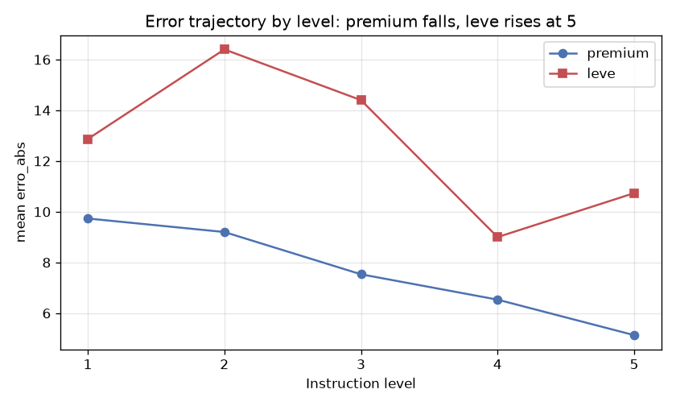

> 🇬🇧 English · 🇧🇷 [Português](README.md)

# AI evaluation of code quality — how much do the instruction and the model matter?

An empirical study: **when we ask an AI to evaluate the quality of a piece of code, how much does the
level of detail in the instruction** we give it matter — and **how much does the model's capacity
matter**?

To answer this, we compared **150 automatic evaluations** of 5 academic software projects, produced
by two AI models under 5 instruction levels, against a reference **human ground truth**.

> **New to the topic?** You don't need to know statistics or AI to follow along. The technical terms
> are explained in the **[GLOSSARY](GLOSSARIO.en.md)** and the study design, step by step, in
> **[1-processo/desenho-experimental.en.md](1-processo/desenho-experimental.en.md)**.

---

## The main finding

The AI's error **drops** as the instruction becomes more detailed — but **excessive** instruction only
hurts the **`leve` (the lighter model)**. It is a "U-shaped effect" **conditional on the model's
capacity**: the strong model is not confused by too much instruction; the weak one is.



In addition, the **premium** model is more accurate, points out **~3× more problems** and is more
**reliable** (it repeats similar scores), at the cost of being **~2.8× more expensive**.

| In numbers | premium (Claude Opus 4.8) | leve (Gemini 3.5 Flash) |
|---|---|---|
| Mean error vs. ground truth | ~7.6 | ~12.7 |
| Problems pointed out (median) | 12 | 4 |
| Reliability (sd across repetitions) | 2.5 (more stable) | 8.0 (~3× noisier) |
| Hallucination rate | 0% | 6.7% |
| Cost per evaluation | ~R$7.9 | ~R$2.8 |

*(Full detail, formulas and tests in the [report](2-resultados/relatorio-final.en.md).)*

---

## How the repository is organized (3 parts)

```
llm-code-quality-eval/
├── 1-processo/      → HOW the study was built (methodology, instrument, lessons)
├── 2-resultados/    → WHAT was found (report, charts, anonymized data)
├── 3-codigos/       → HOW TO RUN (reproduce the collection and the analysis)
├── projetos-base/   → the 5 evaluated projects (deferred — see inside)
├── GLOSSARIO.md     → technical terms in plain language
├── LICENSE          → MIT (code)
└── LICENSE-CONTENT.md → CC BY 4.0 (texts, data, charts)
```

| Part | Start here if you want to… | Highlights |
|---|---|---|
| **[1 — Process](1-processo/)** | understand the **why** and the **how** | [experimental design](1-processo/desenho-experimental.en.md) · [lessons learned](1-processo/licoes-aprendidas.en.md) · [instrument](1-processo/instrumento/) |
| **[2 — Results](2-resultados/)** | see **what came out** | [report (17 parts)](2-resultados/relatorio-final.en.md) · [9 charts](2-resultados/graficos/) · [data](2-resultados/dados/) |
| **[3 — Code](3-codigos/)** | **reproduce** | [how to run](3-codigos/README.en.md) · [collection](3-codigos/coleta/) · [analysis + notebook](3-codigos/analise/) |

### Suggested reading path

1. This README (overview) → 2. [desenho-experimental.en.md](1-processo/desenho-experimental.en.md) (the
   methodology) → 3. [report](2-resultados/relatorio-final.en.md) (the results) → 4.
   [how to run](3-codigos/README.en.md) (if you want to reproduce it).

---

## Quick reproduction (no cost)

The results come from the data already included — you do **not** need to pay for an API:

1. Open the **[notebook in Google Colab](https://colab.research.google.com/drive/1d2QHmFEUB4UFTtklEqs6vscVBlovVApI?usp=sharing)**.
2. Upload the CSVs from [`2-resultados/dados/`](2-resultados/dados/).
3. **Run all.** Charts and statistics appear inline.

The complete step by step (and the path to redo the entire collection) is in
[`3-codigos/README.en.md`](3-codigos/README.en.md).

---

## Anonymization and ethics

The 5 evaluated projects were developed by **other teams** of students and this study **critiques**
their quality. For this reason:

- across the **whole** repository they appear only as **P1–P5**; the real names are nowhere that goes
  to Git (they stay only on the author's machine, in a local configuration file);
- the code of these projects is **not** redistributed here. Future inclusion (via Git submodules) will
  only happen **with each team's authorization** — see [`projetos-base/`](projetos-base/);
- the **free-text fields that quoted the teams' code** (each issue's description, the human gold
  standard's notes and the hallucination-check evidence) are **withheld** from this public version:
  file names, folder names and code excerpts would let readers recognize the teams. None of the
  numbers in the analysis depend on them.

---

## License

Dual license, because there are two kinds of material:

- **Code** (scripts, notebook): **[MIT](LICENSE)**.
- **Content** (report, texts, charts, data/CSVs): **[CC BY 4.0](LICENSE-CONTENT.en.md)**.

The 5 base projects keep the **original license and authorship** of their teams; the licenses above
cover **only the author's work**.

---

## Academic context

Final project for **Applied Statistics** — Technology in Multiplatform Software Development (DSM),
**FATEC**. Author: **Augusto Henrique Buin**. Individual work.

> The numbers and the conclusions always speak in terms of **configuration** (`leve`/`premium`), never
> of brand, because the model's vendor and capacity are confounded in the design (see the report).
