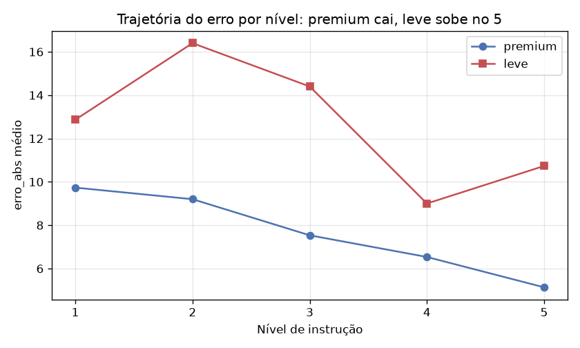

# Avaliação de qualidade de código por IA — quanto a instrução e o modelo importam?

> 🇧🇷 Português (principal) · 🇬🇧 [English](README.en.md)

Um estudo empírico: **quando pedimos a uma IA para avaliar a qualidade de um código, quanto importa o
nível de detalhe da instrução** que damos a ela — e **quanto importa a capacidade do modelo**?

Para responder, comparamos **150 avaliações automáticas** de 5 projetos de software acadêmicos, feitas
por dois modelos de IA sob 5 níveis de instrução, contra um **gabarito humano** de referência.

> **Novo no assunto?** Não precisa saber estatística nem IA para acompanhar. Os termos técnicos estão
> explicados no **[GLOSSÁRIO](GLOSSARIO.md)** e o desenho do estudo, passo a passo, em
> **[1-processo/desenho-experimental.md](1-processo/desenho-experimental.md)**.

---

## O achado principal

O erro da IA **cai** conforme a instrução fica mais detalhada — mas o **excesso** de instrução só
atrapalha o **modelo leve**. É um "efeito-U" **condicional à capacidade do modelo**: o modelo forte
não se confunde com instrução demais; o fraco, sim.



Além disso, o modelo **premium** é mais preciso, aponta **~3× mais problemas** e é mais **confiável**
(repete notas parecidas), ao custo de **~2,8× mais caro**.

| Em números | premium (Claude Opus 4.8) | leve (Gemini 3.5 Flash) |
|---|---|---|
| Erro médio vs. gabarito | ~7,6 | ~12,7 |
| Problemas apontados (mediana) | 12 | 4 |
| Confiabilidade (dp entre repetições) | 2,5 (mais estável) | 8,0 (~3× mais ruidoso) |
| Taxa de alucinação | 0% | 6,7% |
| Custo por avaliação | ~R$7,9 | ~R$2,8 |

*(Detalhe completo, fórmulas e testes no [relatório](2-resultados/relatorio-final.md).)*

---

## Como o repositório está organizado (3 partes)

```
llm-code-quality-eval/
├── 1-processo/      → COMO o estudo foi montado (metodologia, instrumento, lições)
├── 2-resultados/    → O QUE foi encontrado (relatório, gráficos, dados anonimizados)
├── 3-codigos/       → COMO RODAR (reproduzir a coleta e a análise)
├── projetos-base/   → os 5 projetos avaliados (adiado — ver dentro)
├── GLOSSARIO.md     → termos técnicos em linguagem simples
├── LICENSE          → MIT (código)
└── LICENSE-CONTENT.md → CC BY 4.0 (textos, dados, gráficos)
```

| Parte | Comece aqui se você quer… | Destaques |
|---|---|---|
| **[1 — Processo](1-processo/)** | entender o **porquê** e o **como** | [desenho experimental](1-processo/desenho-experimental.md) · [lições aprendidas](1-processo/licoes-aprendidas.md) · [instrumento](1-processo/instrumento/) |
| **[2 — Resultados](2-resultados/)** | ver **o que deu** | [relatório (17 partes)](2-resultados/relatorio-final.md) · [9 gráficos](2-resultados/graficos/) · [dados](2-resultados/dados/) |
| **[3 — Códigos](3-codigos/)** | **reproduzir** | [como rodar](3-codigos/README.md) · [coleta](3-codigos/coleta/) · [análise + notebook](3-codigos/analise/) |

### Roteiro sugerido de leitura

1. Este README (visão geral) → 2. [desenho-experimental.md](1-processo/desenho-experimental.md) (a
   metodologia) → 3. [relatório](2-resultados/relatorio-final.md) (os resultados) → 4.
   [como rodar](3-codigos/README.md) (se quiser reproduzir).

---

## Reproduzir rápido (sem custo)

Os resultados saem dos dados já incluídos — **não** é preciso pagar API:

1. Abra o **[notebook no Google Colab](https://colab.research.google.com/drive/1d2QHmFEUB4UFTtklEqs6vscVBlovVApI?usp=sharing)**.
2. Faça upload dos CSVs de [`2-resultados/dados/`](2-resultados/dados/).
3. **Executar tudo.** Gráficos e estatísticas aparecem inline.

O passo a passo completo (e o caminho para refazer a coleta inteira) está em
[`3-codigos/README.md`](3-codigos/README.md).

---

## Anonimização e ética

Os 5 projetos avaliados foram desenvolvidos por **outras equipes** de estudantes e este estudo
**critica** a qualidade deles. Por isso:

- em **todo** o repositório eles aparecem apenas como **P1–P5**; os nomes reais não estão em lugar
  nenhum que vá para o Git (ficam só na máquina do autor, em arquivo de configuração local);
- o código desses projetos **não** é redistribuído aqui. A inclusão futura (via submódulos Git) só
  acontecerá **mediante autorização de cada equipe** — ver [`projetos-base/`](projetos-base/);
- os **textos livres que citavam o código** das equipes (a descrição de cada problema apontado pela IA,
  as observações do gabarito humano e as evidências da análise de alucinação) foram **omitidos** desta
  versão pública: nomes de arquivo, de pasta e trechos de código permitiriam reconhecer as equipes.
  Nenhum número da análise depende deles.

---

## Licença

Dupla licença, porque há dois tipos de material:

- **Código** (scripts, notebook): **[MIT](LICENSE)**.
- **Conteúdo** (relatório, textos, gráficos, dados/CSVs): **[CC BY 4.0](LICENSE-CONTENT.md)**.

Os 5 projetos-base mantêm a **licença e a autoria originais** de suas equipes; as licenças acima cobrem
**apenas o trabalho do autor**.

---

## Contexto acadêmico

Trabalho Final de **Estatística Aplicada** — Tecnologia em Desenvolvimento de Software Multiplataforma
(DSM), **FATEC**. Autor: **Augusto Henrique Buin**. Trabalho individual.

> Os números e as conclusões falam sempre em termos de **configuração** (`leve`/`premium`), nunca de
> marca, porque fornecedor e capacidade do modelo estão confundidos no desenho (ver o relatório).
